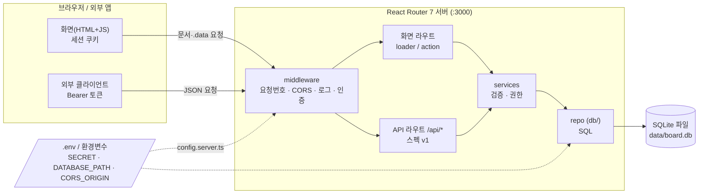
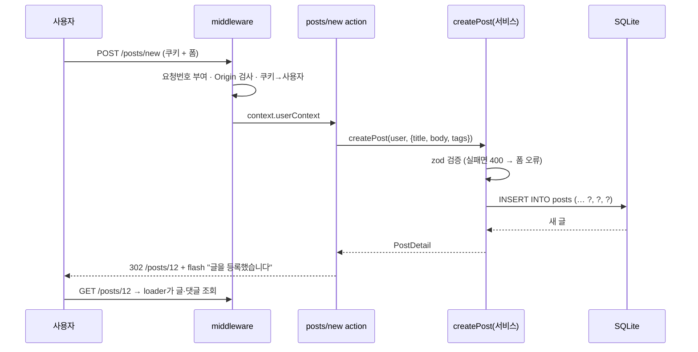

# studyMidpoint — 기초 응용: React Router 7 게시판

> 기준: [노션 · React Router 7](https://app.notion.com/p/40bd7dec5e2e81448f49d0bbc16afe06)의 예제("게시판을 React Router 7로 만들기") · [공통 API 스펙 v1](https://app.notion.com/p/3d6d7dec5e2e8139adbfd36dd506c65e). 코드: [midpoint/](midpoint/) — **study0~10에서 배운 것만** 사용했습니다(외부 서비스·AI·다른 DB 없음).

## ① 목표 한 줄

study0~10에서 배운 것만으로 **React Router 7 하나**로 회원가입·로그인·게시글 CRUD·댓글이 있는 게시판 서비스를 만들고, 1차 배포가 가능한 상태로 점검한다.

**목표 상세**

- 화면(SSR)과 API(`/api`, 스펙 v1)를 **같은 서비스 계층**으로 제공한다.
- 쿠키 세션(화면)과 Bearer 토큰(API)으로 로그인하고, 남의 글·댓글은 고칠 수 없다.
- 테스트(단위 29 + 요청 74)와 Docker 이미지까지 갖춘다.
- 이 단계에서는 **쓰지 않는다**: 다른 DB, 결제·메일·OAuth, AI, WebSocket, CI 배포(→ study11~18, studyFinal).

## ② 📖 이론 — 기능 목록과 설계 근거

### 기능 목록

| # | 기능 | 화면 주소 | API(스펙 v1) | 배운 곳 | 핵심 파일 |
| --- | --- | --- | --- | --- | --- |
| 1 | 홈(최근 글 5개) | `GET /` | — | study1 | `routes/home.tsx` |
| 2 | 글 목록·검색·정렬·쪽 | `GET /posts?q=&sort=&page=` | `GET /api/posts` | study3·4 | `routes/posts/list.tsx` |
| 3 | 글 상세(+댓글 목록) | `GET /posts/:postId` | `GET /api/posts/{id}`, `…/comments` | study4·6 | `routes/posts/detail.tsx` |
| 4 | 회원가입 | `POST /signup` | `POST /api/auth/signup` | study5·7 | `routes/signup.tsx` |
| 5 | 로그인·로그아웃 | `POST /login`, `POST /logout` | `POST /api/auth/login`, `…/logout`, `GET …/me` | study7 | `routes/login.tsx` |
| 6 | 글쓰기 | `POST /posts/new` | `POST /api/posts` | study5 | `routes/posts/new.tsx` |
| 7 | 글 수정(작성자만) | `POST /posts/:postId/edit` | `PATCH /api/posts/{id}` | study5·7 | `routes/posts/edit.tsx` |
| 8 | 글 삭제(작성자만) | `POST /posts/:postId`(intent) | `DELETE /api/posts/{id}` | study6·7 | `routes/posts/detail.tsx` |
| 9 | 댓글 작성·삭제 | 상세 화면(`useFetcher`) | `POST /api/posts/{id}/comments`, `DELETE /api/comments/{id}` | study5 | `routes/posts/detail.tsx` |
| 10 | 오류 화면(404·403) | `ErrorBoundary` | JSON 오류(스펙 5절) | study4 | `root.tsx`, `posts/layout.tsx` |
| 11 | 건강 확인 | — | `GET /health` | study10 | `routes/health.ts` |
| 12 | 최근 검색어(브라우저) | `/posts` | — | study3 | `lib/use-local-storage.ts` |

**규모**: `app/` 51개 파일·약 2,150줄(TS/TSX/CSS), 라우트 파일 21개, 운영 의존성 7개(`react`, `react-dom`, `react-router`, `@react-router/node`, `@react-router/serve`, `isbot`, `zod`).

### 왜 이 순서로 만드나: 아래에서 위로, 한 줄기씩

화면부터 만들면 데이터가 없어 막힙니다. 그래서 **데이터(아래) → 규칙 → 입구 → 화면(위)** 순서로 쌓고, **각 단계 끝에서 눈으로 확인**합니다. 각 단계가 끝나면 커밋합니다(`feat: …`).

### 폴더 구조

```text
midpoint/
├─ app/
│  ├─ root.tsx · routes.ts · entry.server.tsx · app.css
│  ├─ config.server.ts · session.server.ts · context.ts
│  ├─ routes/            화면 11개 + API 9개 + health (21개 라우트 파일)
│  │  ├─ api/            auth-{signup,login,logout,me}, posts, post, post-comments, comment, not-found
│  │  └─ posts/          layout, list, detail, new, edit
│  ├─ components/        header, pagination, post-form, field-error
│  ├─ services/          auth, posts, comments            (업무 규칙)
│  ├─ db/                types, sqlite.server, index.server (저장소)
│  ├─ middleware/        request.server, auth.server
│  └─ lib/               errors, schemas, validate, http·api·form·route-error(.server), password, token, format, use-local-storage
├─ tests/                7개 테스트 파일 + setup.ts
├─ tools/request-test.mjs
├─ Dockerfile · .dockerignore · .env.example · package.json …
```

### 비유

게시판은 **작은 도서관**입니다. 서가(DB)에 책(글)이 꽂혀 있고, 사서(서비스)가 "누가 빌릴 수 있는지"를 판단하며, 대출 창구(라우트)가 손님(브라우저·앱)을 맞고, 회원증(세션·토큰)을 확인하는 출입 게이트(미들웨어)가 있습니다. 창구가 두 개(화면 창구·API 창구)여도 **사서는 같은 사람**이라 규칙이 어긋나지 않습니다.

## ③ 🛠️ 실기 — 단계별 구현 순서와 핵심 코드

### 단계별 구현 순서

| 단계 | 할 일 | 파일 | 눈으로 확인 | 배운 곳 |
| --- | --- | --- | --- | --- |
| 1 | 프로젝트 생성·`.env`·Git | `package.json`, `.env.example` | `npm run dev`로 첫 화면 | [study0](study0.md) |
| 2 | **모델(타입)** 정의 | `db/types.ts` | 타입 검사(`npm run typecheck`) | [study3](study3.md) |
| 3 | **스키마·저장소** | `db/sqlite.server.ts` | 메모리 DB로 서비스 테스트 | [study6](study6.md) |
| 4 | **서비스**(검증·권한) | `services/*.server.ts`, `lib/schemas.ts` | `npm test` | [study5](study5.md)·[6](study6.md) |
| 5 | **공통 오류·응답** | `lib/errors.ts`, `http.server.ts`, `api.server.ts` | 단위 테스트 | [study6](study6.md)·[8](study8.md) |
| 6 | **API 라우트**(스펙 v1) | `routes/api/*`, `routes.ts` | `curl.exe`로 CRUD | [study4](study4.md)·[6](study6.md) |
| 7 | **인증** 미들웨어·세션·토큰 | `middleware/auth.server.ts`, `session.server.ts` | 토큰 없이 401, 위조 401 | [study7](study7.md) |
| 8 | **화면 틀**: `root`, 헤더, 오류 화면 | `root.tsx`, `components/header.tsx` | 오류 화면, 404 | [study2](study2.md)·[4](study4.md) |
| 9 | **목록·상세** (`loader`) | `routes/posts/list.tsx`, `detail.tsx` | 검색·쪽 이동 | [study1](study1.md)·[3](study3.md) |
| 10 | **가입·로그인** (`action`·세션) | `routes/signup.tsx`, `login.tsx`, `logout.ts` | 새로고침해도 로그인 유지 | [study5](study5.md)·[7](study7.md) |
| 11 | **글쓰기·수정·삭제·댓글** | `routes/posts/new.tsx`, `edit.tsx`, `detail.tsx` | 남의 글 수정 403 | [study5](study5.md) |
| 12 | **요청 테스트·Docker** | `tools/request-test.mjs`, `Dockerfile` | 74개 통과, 컨테이너 `healthy` | [study9](study9.md)·[10](study10.md) |

**실행해서 따라 하기**

```powershell
cd midpoint
npm ci
Copy-Item .env.example .env       # SESSION_SECRET·JWT_SECRET 32자 이상 채우기(study0)
npm run typecheck                 # 타입 오류 없음
npm test                          # 29개 통과
npm run build
npm run test:requests             # 74개 통과 (임시 DB로 서버를 띄워 HTTP 전체 확인)
npm run dev                       # http://localhost:5173
```

### 핵심 코드 ①: 모든 요청의 순서를 정하는 한 줄

**`midpoint/app/root.tsx`** — 실제 파일 20–21줄 · [파일 열기](midpoint/app/root.tsx#L20-L21)

```tsx
// 배열 순서대로 실행된다: 요청 번호·CORS·로그 → 사용자 확인 → (각 라우트) → 응답이 거꾸로 돌아온다.
export const middleware: Route.MiddlewareFunction[] = [requestMiddleware, authMiddleware];
```

줄 번호는 위 코드의 첫 줄을 1로 셉니다.

| 줄 | 코드 | 설명 |
| --- | --- | --- |
| 1 | <code>// 배열 순서대로 실행된다: 요청 번호·CORS·로그 → 사용자 확인 → (각 라…</code> | 주석: 요청이 들어올 때와 나갈 때의 순서. |
| 2 | <code>export const middleware: Route.MiddlewareFunct…</code> | `[requestMiddleware, authMiddleware]`. 들어올 때는 **요청번호·CORS·로그 → 인증** 순서로 실행되고, 응답은 거꾸로 돌아 나가며 헤더·로그가 붙는다. 이 한 줄이 서비스 전체의 "문지기"다. |

### 핵심 코드 ②: 글 상세 화면 하나가 읽기·댓글·삭제를 모두 처리한다

**`midpoint/app/routes/posts/detail.tsx`** — 실제 파일 31–58줄 · [파일 열기](midpoint/app/routes/posts/detail.tsx#L31-L58)

```tsx
// 한 라우트에 action이 하나뿐이라 hidden input "intent"로 무엇을 할지 나눈다.
export async function action({ request, params, context, url }: Route.ActionArgs) {
  const user = requireUser(context, url);
  const form = await request.formData();
  const intent = form.get("intent");
  try {
    const postId = parseId(params.postId);
    switch (intent) {
      case "comment": {
        const values = readFields(form, ["body"]);
        await createComment(user, postId, values);
        return { ok: true as const };
      }
      case "delete-comment":
        await deleteComment(user, parseId(String(form.get("commentId") ?? "")));
        return { ok: true as const };
      case "delete-post":
        await deletePost(user, postId);
        return await redirectWithFlash(request, "/posts", "글을 삭제했습니다.");
      default:
        throw data("알 수 없는 요청입니다.", { status: 400 });
    }
  } catch (error) {
    // 입력 오류(400·422)는 폼에 보여 주고, 권한·존재 오류는 오류 화면으로 보낸다.
    if (error instanceof AppError && error.fields) return failure(error, readFields(form, ["body"]));
    return routeError(error);
  }
}
```

줄 번호는 위 코드의 첫 줄을 1로 셉니다.

| 줄 | 코드 | 설명 |
| --- | --- | --- |
| 1 | <code>// 한 라우트에 action이 하나뿐이라 hidden input "intent"로…</code> | 주석: `intent`로 일을 나눈다. |
| 2 | <code>export async function action({ request, params…</code> | `POST /posts/12`를 받는다. |
| 3 | <code>const user = requireUser(context, url);</code> | 로그인하지 않았으면 `/login?redirectTo=…`로 보낸다. |
| 4 | <code>const form = await request.formData();</code> | 폼을 한 번만 읽는다. |
| 5–6 | <code>const intent = form.get("intent");</code> | 숨은 필드 `intent`가 무슨 일인지 알려 준다. |
| 7 | <code>const postId = parseId(params.postId);</code> | 주소의 id 검증. |
| 8 | <code>switch (intent) {</code> | `comment` · `delete-comment` · `delete-post`. |
| 9–11 | <code>case "comment": {</code> | 댓글 작성: 서비스가 검증·저장. |
| 12–13 | <code>return { ok: true as const };</code> | `fetcher`가 성공을 알아채고 입력칸을 비운다. 끝나면 화면의 `loader`가 **자동 재실행**되어 새 댓글이 보인다. |
| 14–16 | <code>case "delete-comment":</code> | 내 댓글만(서비스가 403 판단). |
| 17–19 | <code>case "delete-post":</code> | 글 삭제 후 목록으로 redirect + flash. |
| 20–22 | <code>default:</code> | 모르는 `intent`는 400. |
| 23–24 | <code>} catch (error) {</code> | 입력 오류는 폼에, 그 밖은 오류 화면으로. |
| 25 | <code>if (error instanceof AppError &amp;&amp; error.fields)…</code> | 필드 오류(예: 빈 댓글)는 `failure`로 폼 아래에 표시. |
| 26–28 | <code>return routeError(error);</code> | 권한(403)·없음(404)은 `ErrorBoundary`로. |

## ④ 🔗 연동 포인트 — DB·API 연동 구성도

### 구성도



### 글쓰기 한 번의 여정(시퀀스)



### 계층 사이를 잇는 "약속"

| 연결 | 약속(어디에 적혀 있나) | 어기면 |
| --- | --- | --- |
| 브라우저 ↔ 서버 | 경로와 폼/JSON 필드(스펙 v1) | 400 `VALIDATION_ERROR` |
| 라우트 ↔ 서비스 | 함수 인자(`user`, `input`)와 던지는 `AppError` | 타입 오류, 상태 코드 불일치 |
| 서비스 ↔ 저장소 | `Repo` 인터페이스(`db/types.ts`) | 타입 오류 |
| 저장소 ↔ DB | 스키마(마이그레이션) | SQL 오류 |
| 앱 ↔ 환경 | `.env.example`의 변수 목록 | 시작 단계 실패 |

## ⑤ 오류 노트 — 이 게시판을 만들며 실제로 겪은 것

| 증상 | 원인 | 해결 |
| --- | --- | --- |
| `/posts/abc`가 500 오류 화면 | 서비스의 `BAD_REQUEST`를 그대로 던져 "예상 밖 오류"로 취급 | `routeError`로 404 변환 + 요청 테스트에 고정 |
| 개발 서버 경고 "Route middleware support is changing in v8" | 미래 플래그를 켜지 않음 | `react-router.config.ts`의 `future.v8_*` 5개를 켠다 |
| `request.url`에 `.data`가 보임 | `v8_passThroughRequests` 활성 | `loader`·`middleware`의 `url` 인자를 쓴다 |
| 컨테이너에서 가입이 500 | Git Bash가 `-e DATABASE_PATH=/app/…`를 `C:/Program Files/Git/app/…`로 변환 | `MSYS_NO_PATHCONV=1` 또는 PowerShell |
| 서버/브라우저 날짜가 달라 Hydration 경고 | `toLocaleDateString`이 시간대에 따라 다른 글자 | `Intl.DateTimeFormat`에 `timeZone: "Asia/Seoul"` 고정 |
| 수정(PATCH) 때 태그가 지워짐 | 수정 스키마에 `.default([])` | `optional()`만 사용 + 테스트로 고정 |
| 테스트 정리 중 `EPERM` | 열린 DB 파일을 Windows가 못 지우게 함 | 지우기 전에 연결을 닫는다 |
| `ExperimentalWarning: SQLite` | `node:sqlite`가 실험 기능 | 정상. 운영 부담이면 study11의 외부 DB |

## ⑥ 직접 해보기

1. **태그 필터**를 추가한다(`GET /posts?tag=intro`, `GET /api/posts?tag=intro`). 어느 층을 어떤 순서로 고칠지(`parseListQuery` → `ListParams` → `repo.posts.list` → 화면 링크) 먼저 적고, 서비스 테스트를 먼저 쓴 뒤 구현한다.
2. **페이지 크기 선택**(10·20·50)을 목록 화면에 추가한다. 스펙의 `limit` 범위(1~50)가 이미 보정돼 있으므로 화면 쪽만 고치는 것이 맞는지 확인한다.
3. 새 폴더에서 **1~6단계만** 따라 해 API만 먼저 만들고 `curl.exe`로 CRUD를 확인한 뒤, 7~11단계로 화면을 얹어 본다("API 먼저" 방식이 화면 먼저보다 어떤 점이 쉬운지 한 줄로 적는다).

## ⑦ ☐ 체크리스트 — 1차 배포 체크리스트

**코드·테스트**

- [ ] `npm run typecheck`, `npm test`(29), `npm run build`, `npm run test:requests`(74)가 모두 통과한다.
- [ ] 스펙 v1 대응표(study6)의 항목이 모두 구현돼 있다(경로·`data/meta`·`error`·`Location`·204·`X-Request-Id`).
- [ ] 남의 글 수정·삭제 403, 비로그인 작성 401, 없는 글 404, 중복 이메일 409를 확인했다.

**보안**

- [ ] 비밀번호가 해시로만 저장되고 응답 어디에도 해시·비밀번호가 없다.
- [ ] 세션 쿠키가 `HttpOnly`·`SameSite=Lax`이고, HTTPS 운영에서는 `Secure`다.
- [ ] `SESSION_SECRET`·`JWT_SECRET`이 서로 다른 32자 이상 무작위 값이고 Git·이미지에 없다.
- [ ] `CORS_ORIGIN`이 필요한 출처만 담고 있다.

**배포**

- [ ] `docker build`가 성공하고 컨테이너가 `healthy`이며 `node` 사용자로 실행된다.
- [ ] `/app/data`가 볼륨이고, 컨테이너를 재시작해도 글이 남는다.
- [ ] 배포 후 점검표(study10) 9개를 모두 확인했다.
- [ ] 이전 이미지로 되돌리는 방법(태그)을 알고 있다.

**문서·정리**

- [ ] `.env.example`이 현재 필요한 모든 변수를 담고 있다.
- [ ] README의 실행 방법대로 처음 보는 사람이 15분 안에 띄울 수 있다.

## ⑧ 다음 단계 연결과 회고

### 회고 (이 순서로 적는다)

| 순서 | 질문 | 이 저장소에서의 예(작성 예시) | 내 기록 |
| --- | --- | --- | --- |
| 1 | **무엇을 만들었나** | 가입·로그인·글 CRUD·댓글·검색·쪽 이동이 있는 SSR 게시판 + 스펙 v1 API, 테스트 102개 | |
| 2 | **잘된 점** | route→service→repo 분리 덕분에 화면과 API가 같은 규칙을 썼고, 서비스 테스트를 DB 없이도 짤 수 있었다 | |
| 3 | **어려웠던 점** | 7.18의 미래 플래그(`url`, 미들웨어 반환 규칙)를 문서와 실제 타입으로 확인해야 했다. `/posts/abc` 500처럼 "예상한 오류"와 "예상 못 한 오류"의 경계 | |
| 4 | **배운 점** | `loader`·`action`이 데이터 흐름의 중심이라 `useEffect`+`fetch` 코드가 거의 필요 없었다. 재검증이 상태 동기화를 대신해 준다 | |
| 5 | **다음에 바꿀 것** | SQLite → PostgreSQL(서버 여러 대), 메일·결제·OAuth, 요약 AI, 자동 배포 | |

이제 이 게시판을 **심화**합니다. [study11.md](study11.md)에서 DB를 MariaDB·PostgreSQL·MongoDB로 바꿔 끼우는 것부터 시작합니다.
